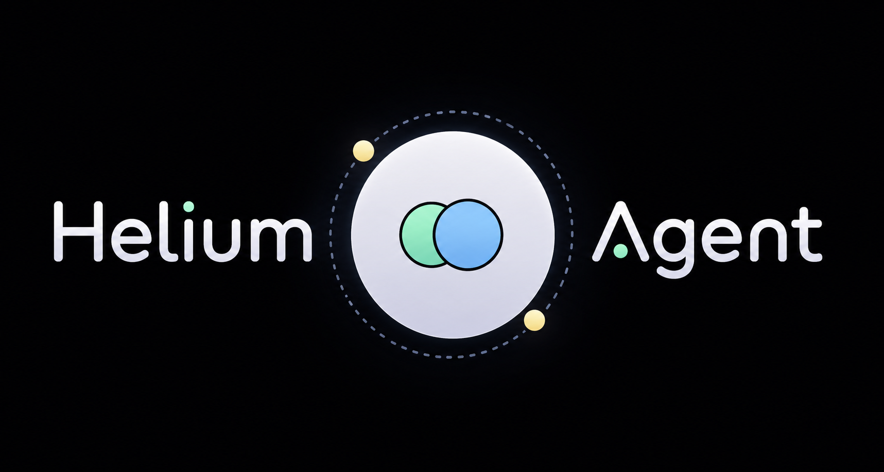

# Helium Agent

## Demo

**[Watch the demo video →](https://youtu.be/JUzYe-BmOa0)**

Helium is a lightweight local AI agent that does everything your everyday agent does but without the massive bill and with your own customization. You can run any LLM be it local or cloud inside Helium. But to have the total experience of freedom I would suggest to integrate a local LLM either using ollama, llama.cpp or any inference technology of your choice.

Helium is still developing and more features are added as you read this. I would really love for you to contribute to this and make a part of Helium your own.

> [!TIP]
> If you directly want to try go to [usage](#usage) section.

## What It Can Do

- **Answer everyday questions:** Just like any other agent it can repsond to any mundane queries you might have. It won't judge you.
- **Tool calling:** Helium uses native OpenAI-compatible tool calling (several tools per turn, in parallel when they are read-only), and falls back to a text protocol for models or servers that don't support tools.
- **Coding**: `/code` runs an agentic loop that explores the project, plans, edits files with precise multi-edits, runs your tests, and reports what changed. `/undo` reverts its last file change.
- **Project instructions:** Put a `HELIUM.md` in your project (or let `/init` write one) and Helium follows it in every conversation.
- **Deep Research:** For queries that include an `in-depth` knowledge and information retrieval Helium will take help of its research tool to provide with most accurate repsonse with proper citations.
- **Web Search:** It can use `DuckDuckGoSearch` API to get web results and if necessary it will use `playwright` to dig deeper into complex websites all to make sure you get the best answer.
- **RAG:** Currently a simple RAG pipeline is integrated where only 1 file at a time can be given to Helium and it will respond accordingly. [Future plans to scale this]
- **Bash execution:** Helium can perform `safe` bash operations in its terminal.
- **Long-term memory:** Facts and preferences are stored in SQLite, one database per project, and Helium picks up where the last session in that project left off.
- **Streaming:** Answers stream into the terminal as they are generated, with a line for each tool Helium uses.

## Prerequisites

Helium is optimized for **macOS on Apple Silicon** but I have tested it across platforms so you shouldn't face any problems but if you do please raise `issue`.

You will need:

- Python 3.10+
- Any OpenAI-compatible chat completions endpoint: a local server (llama.cpp, Ollama, LM Studio, vLLM) or a hosted API (OpenRouter and others).

Default service URLs are configured in [`config/settings.py`](config/settings.py) and can be overridden in [`config/settings.toml`](config/settings.toml).

## Usage

Helium is packaged to `pypi` so you can just download it and use it directly.

Just install it using `pip`:

```Bash
pip install helium-agent
```

Now, go to the directory where you want Helium to work and just call it:

```bash
helium .
```

For more commands type `/help` in the chat.

### Commands

| Command | What it does |
| --- | --- |
| `/help` | Show the help guide. |
| `/code <task>` | Agentic coding: explore, plan, edit, verify, and report changes. |
| `/deep-research <task>` | Multi-source research report with citations. |
| `/init` | Inspect the project and write a `HELIUM.md` with project instructions. |
| `/undo` | Revert the last file change Helium made (shell-command changes are not covered). |
| `/model [name] [--save]` | Show the model, or switch it for this session (`--save` keeps it). |
| `/usage` | Token and tool usage for this session. |
| `/clear` | Clear the conversation (memories and files are kept). |
| `/skills` | List, create, or remove skills. |
| `@path/to/file <question>` | Ask about a file through the RAG service. |

When Helium asks to run a risky tool, answer `y`, `n`, or `a` to allow that tool (or that exact shell command) for the rest of the session. `helium . --nuclear` skips all confirmations.

### Project instructions (HELIUM.md)

Helium reads `HELIUM.md` (or `.helium/HELIUM.md`) from the project root and adds it to every prompt, the same way you would brief a new teammate: build and test commands, layout, conventions, and gotchas. Run `/init` to have Helium draft one.

### Tool-calling mode

By default (`tool_mode = "auto"` in [`config/settings.toml`](config/settings.toml)) Helium sends tool schemas using the OpenAI `tools` API. If the endpoint rejects them, Helium switches to its text `<action>` protocol for that model automatically. Set `tool_mode = "text"` or `"native"` to force one.

## Docker

> [!NOTE]
> Use this if you just want to chat without worrying the technical complexities but make sure to have you `env` configured accordingly.
>
> It will take care of RAG pipeline automatically.

You can build and run the entire terminal application using:

```bash
docker compose up --build
```

You might need to wait for a bit. So, go have a coffee while it is building.

This will run the image:

```bash
docker compose run --rm --service-ports helium
```

The API container is configured to reach host services through `host.docker.internal`. Keep llama.cpp instance running on the host, then update [`docker-compose.yml`](docker-compose.yml) if your ports differ.

## Dev Installation

> [!NOTE]
> Use this only if you want to run it manually otherwise go to [Docker](#docker) section.

1. Clone the repository:

   ```bash
   git clone <repository-url>
   cd helium-agent
   ```

2. Create and activate a virtual environment:

   ```bash
   python -m venv .venv
   source .venv/bin/activate
   ```

3. Install Python dependencies:

   ```bash
   pip install -r requirements.txt
   pip install -r requirements-rag.txt
   ```

4. Doctor command for RAG check:

   ```bash
   python -m rag_service doctor
   ```

## Local Services

> [!NOTE]
> You can either use llama.cpp or any LLM provider API.

### Start llama.cpp

Run a compatible instruction-tuned GGUF model on port `3000`:

```bash
./llama-server -m /path/to/your/model.gguf -c 4096 --port 3000
```

Helium expects an OpenAI-compatible chat completions endpoint:

```text
http://127.0.0.1:3000/v1/chat/completions
```

For Ollama use `http://localhost:11434/v1/chat/completions` (not the native `/api/chat` endpoint).

### Use LLM API

Run `helium` and follow the setup wizard. The API key, URL, model, and Playwright toggle are saved to `config.toml` in your user Helium config directory, readable only by your user (`chmod 600`).

You can still use environment variables for CI, Docker, or temporary overrides:

```text
LLM_API_KEY=your-llm-api-key
LLM_API_URL=your-llm-url
LLM_MODEL=your-model
```

If you previously used `~/.helium.env`, Helium can import it into the config file during setup. The legacy file is left untouched, so remove it yourself after confirming the import worked.

### Start Playwright

Helium comes with playwright compatibility. So, if you want to get more in-depth results from web you can turn on this feature by updating `use_playwright=true` in `config/settings.toml`

Then install playwright and chromium.

```bash
pip install playwright
playright install chromium
```

> These are not added in `requirements.txt` because Helium aims to be lightweight. But you can do whatever you want!

> [!TIP]
> Playwright is heavy as it downloads chromium so it can take some of your memory. Use with caution.

### Start RAG pipeline

Helium comes with its own RAG pipeline. This allows you to add files with `@` prefix to the file path to your file. Then you can ask anything about that file.

Retrieval is lexical (keyword-based), so it needs no model downloads. It is good at answering what is inside a file, summarizing it, and other basic questions.

This is an **optional** feature. Look into `rag_service` directory for more detail.

## Run The Assistant

1. Confirm the LLM service is running.
2. Confirm your web services are running if you want better results.
3. Start Helium:

   ```bash
   python main.py
   ```

4. Wait for:

Animation to load and welcome message to be shown.

5. Type your query and enjoy Helium.

Example requests:

```text
What is the latest news on AI?
Remember that I prefer concise responses.
Create a file named hello.txt that says hi.
Open Safari.
Compare India and China GDP in 2025.
Why is the Indian Rupee falling recently?
Give me a report on the latest AI regulation changes in the EU.
```

RAG request example:

```text
@README.md what does this project do?
@docs/plan.pdf summarize the risks
```

## Testing

Run the test suite from the repository root:

```bash
uv run pytest tests -q --ignore=tests/test_eval_graders.py --ignore=tests/test_eval_runner.py --ignore=tests/test_eval_schema.py
```

The tests never call a real LLM endpoint and keep memory and history in a temporary directory.


